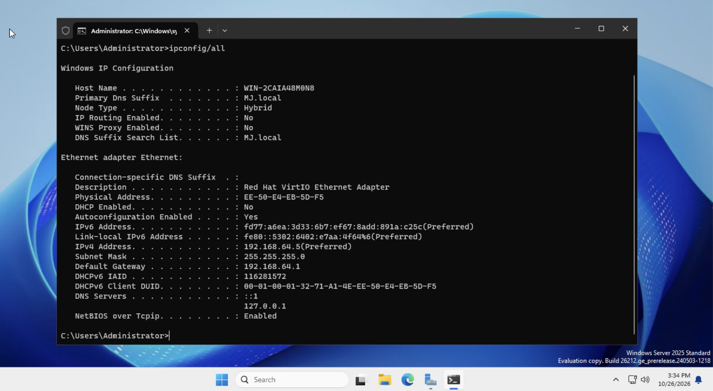
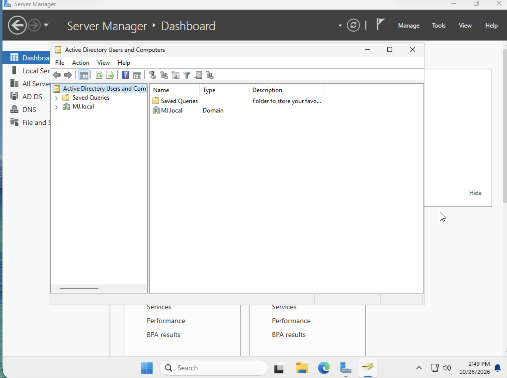
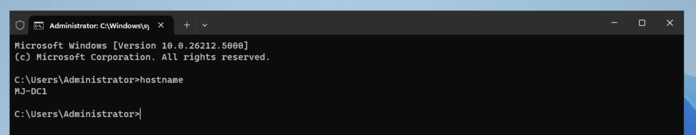
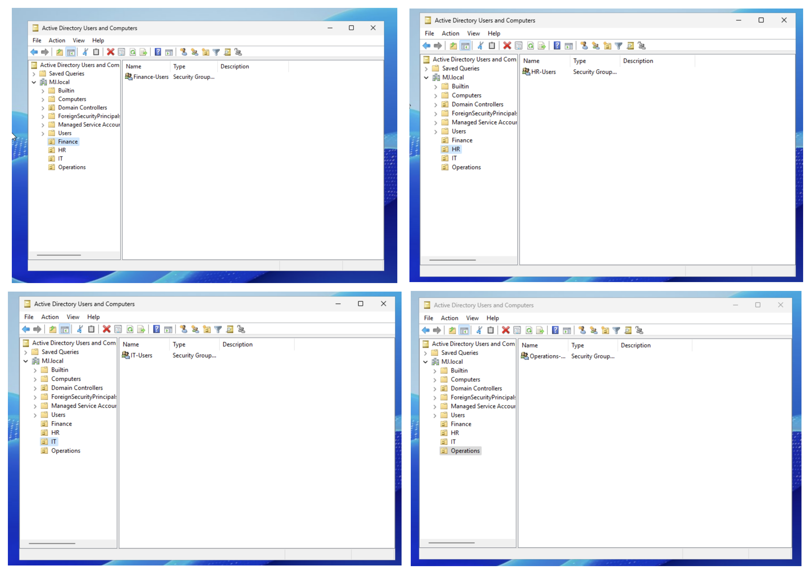
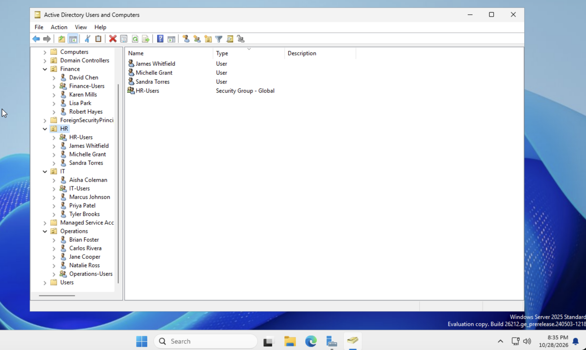
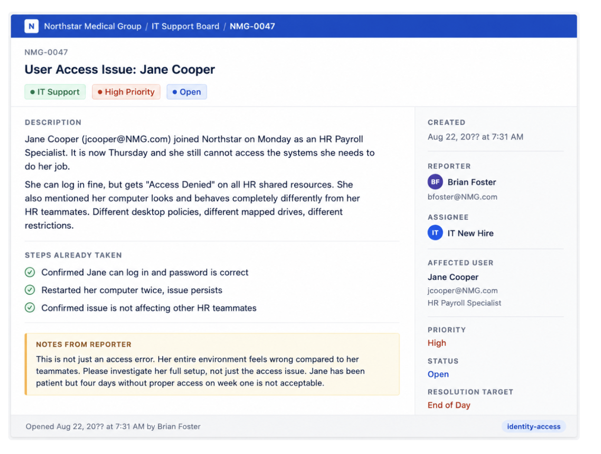
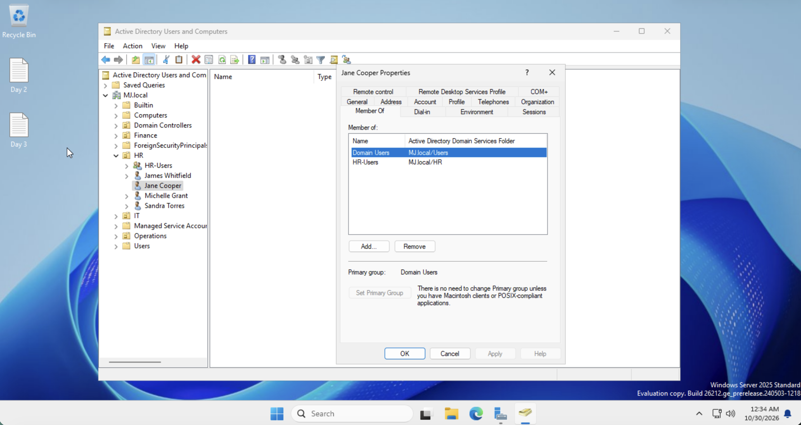
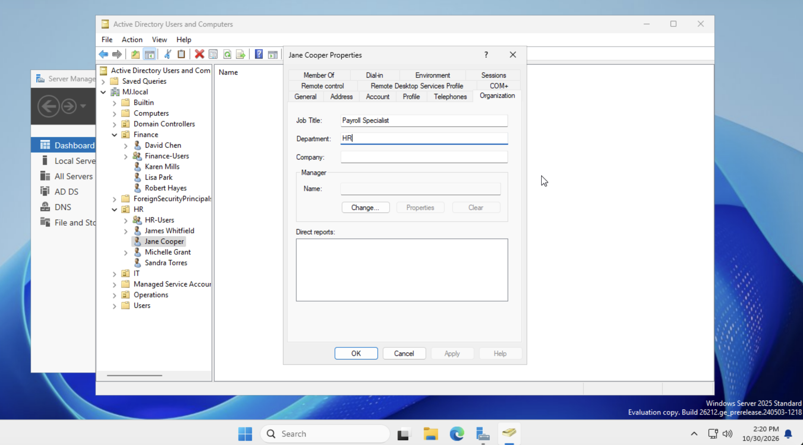

# Rebuilding Active Directory for Northstar Medical Group

**Mujeeb Adeyemi Balogun** · October 26–30, 2026

Northstar Medical Group inherited a disorganized Active Directory from its previous IT provider. Over one week I rebuilt its identity foundation in a home lab: a new domain controller, a department structure, 15 consistently named staff accounts with role-based access, and a first support ticket resolved by root-cause analysis. This edition covers the core objectives of each day; a full edition adds the Day 1 troubleshooting.

> This lab uses MJ.local in place of the training scenario's NMG.com; names and sign-ins follow that domain.

| Item | Value |
|---|---|
| **Scenario** | Northstar Medical Group (training case) |
| **Platform** | UTM on an M1 Mac, ARM64 VM |
| **Server** | Windows Server 2025, MJ-DC1 |
| **Domain** | MJ.local, single forest |
| **Directory** | 4 OUs, 4 groups, 15 users |
| **Ticket** | NMG-0047, resolved |

**Tools:** `Windows Server 2025` · `AD DS` · `DNS` · `ADUC` · `netdom` · `dcdiag` · `RBAC`

## Repository contents

| Folder | What's inside |
|---|---|
| [`docs/`](docs/) | Day-by-day reports, the full edition of this case study, the user list and the NMG-0047 resolution |
| [`screenshots/`](screenshots/) | Time-stamped evidence from every stage, prefixed by day |

This README covers each day's core objectives. The **[full edition](docs/case-study-full-edition.md)** adds the troubleshooting behind the Day 1 build.

## Contents

- [1. The problem at Northstar](#1-the-problem-at-northstar)
- [2. What I built](#2-what-i-built)
- [3. Day 1: Building the domain](#3-day-1-building-the-domain)
- [4. Day 2: Organizing by department](#4-day-2-organizing-by-department)
- [5. Day 3: People and permissions](#5-day-3-people-and-permissions)
- [6. Day 4: Ticket NMG-0047](#6-day-4-ticket-nmg-0047)
- [7. Results](#7-results)
- [8. Skills demonstrated](#8-skills-demonstrated)
- [9. Lab choices and what I would do in production](#9-lab-choices-and-what-i-would-do-in-production)
- [10. Next steps](#10-next-steps)

## 1. The problem at Northstar

Northstar Medical Group, a healthcare provider, was leaving a managed service provider (MSP) whose Active Directory had no structure. Its IT manager, Jordan M. Hayes, described the state of it:

- Users added manually and at random, with no naming or department structure.
- Inconsistent access: some staff had more permissions than their job needed, others less.
- Leavers' accounts left enabled for months; new starters waiting days for access.
- No documentation of any of it.

Because Northstar handles patient data, this was also a compliance risk. HIPAA expects every person to have a unique login and access to be controlled and reviewable. The brief was to rebuild the identity infrastructure from scratch, properly, over one week.

## 2. What I built

Over four working days I built the directory in layers, each depending on the one before:

| Day | Objective | Outcome |
|---|---|---|
| 1 | Build the domain | Windows Server 2025 domain controller MJ-DC1, forest MJ.local, healthy by dcdiag |
| 2 | Organize it | 4 department OUs (Finance, HR, IT, Operations), each with a global security group |
| 3 | Populate it | 15 staff accounts under one naming convention; role-based group membership |
| 4 | Support it | Ticket NMG-0047: diagnosed a misprovisioned account, fixed both root causes, documented |

```bat
MJ.local                      forest root, DC: MJ-DC1 (192.168.64.5)
├── Finance      OU   Finance-Users     (dchen, kmills, rhayes, lpark)
├── HR           OU   HR-Users          (storres, jwhitfield, mgrant, jcooper)
├── IT           OU   IT-Users          (mjohnson, ppatel, tbrooks, acoleman)
└── Operations   OU   Operations-Users  (bfoster, crivera, nross)
```

The tree shows the final state, after the Day 4 ticket moved Jane Cooper from Operations to HR.

## 3. Day 1: Building the domain

The goal was a working, healthy domain controller to build everything else on.

| Step | What I did | Why |
|---|---|---|
| Virtual machine | ARM64 VM in UTM on an M1 Mac, 4 GB RAM | Apple Silicon runs ARM64 guests natively; x64 Windows would need slow emulation |
| Operating system | Windows Server 2025 Standard (Desktop Experience), ARM64 build 26212 | An ARM64 server build that runs on the VM |
| Network | Static IP 192.168.64.5/24, gateway 192.168.64.1, DNS 127.0.0.1 and ::1 | A DC needs a fixed address and must resolve its own AD records |
| Domain | Installed AD DS and DNS; promoted to the first DC of the new forest MJ.local | Creates the directory every account will live in |
| Naming | Renamed the DC from WIN-2CAIA48M0N8 to MJ-DC1 with `netdom` | A meaningful name; netdom updates the DC's DNS and directory records |
| Health check | Ran `dcdiag`; confirmed SYSVOL and NETLOGON are shared | Proves the DC is healthy before building on it |



*Figure 1. `ipconfig /all` on the DC: DHCP off, static 192.168.64.5, DNS pointing to loopback, primary DNS suffix MJ.local.*



*Figure 2. Active Directory Users and Computers showing the new MJ.local domain, with AD DS and DNS installed.*



*Figure 3. `hostname` returns MJ-DC1 after the rename.*

dcdiag passed every test except DFSREvent, which reported startup errors logged during the build; I checked the DFS Replication log and confirmed SYSVOL is healthy.

## 4. Day 2: Organizing by department

I created one organizational unit (OU) per department and one global security group inside each. The two do different jobs: an **OU** organizes accounts and is where Group Policy and delegated administration apply; a **security group** is what actually grants access.

| OU | Security group | Department at Northstar |
|---|---|---|
| Finance | `Finance-Users` | Billing, claims, payroll and accounts |
| HR | `HR-Users` | Hiring, employee records and benefits |
| IT | `IT-Users` | Systems administration and help desk |
| Operations | `Operations-Users` | Clinic operations, scheduling and facilities |



*Figure 4. Each department OU holding its security group.*

## 5. Day 3: People and permissions

I created 15 accounts, each in its department's OU, under one naming convention: first initial plus surname, lowercase (`dchen`). Consistent attributes matter because other systems, such as cloud directories and HR platforms, match users by them; one mismatch can break a sync without an obvious error. The convention also separates people who share a surname, such as Robert Hayes (`rhayes`) and Jordan Hayes (`jhayes`).

Each user joined their department's group. That is role-based access control (RBAC): access is granted to a role once, not to each person. It addresses broken access control, ranked first (A01) in the 2025 OWASP Top 10, and makes least privilege practical.

| Group | Members | Count |
|---|---|---|
| `Finance-Users` | dchen, kmills, rhayes, lpark | 4 |
| `HR-Users` | storres, jwhitfield, mgrant | 3 |
| `IT-Users` | mjohnson, ppatel, tbrooks, acoleman | 4 |
| `Operations-Users` | bfoster, jcooper, crivera, nross | 4 |



*Figure 5. All 15 accounts and 4 groups in their OUs at the end of Day 3, 8:35 PM on October 28.*

## 6. Day 4: Ticket NMG-0047

Jane Cooper, a new HR Payroll Specialist, could sign in but got "Access Denied" on HR resources, and her desktop behaved differently from her HR teammates. The ticket asked for her full setup to be investigated, not just the error.



*Figure 6. Ticket NMG-0047 as received.*

I compared her account with her teammates' before changing anything, and traced both symptoms with the Five Whys to one root cause: her account had been provisioned to the wrong department (a fault planted on Day 3). That produced two separate problems:

| Problem | Effect | Fix |
|---|---|---|
| Wrong group: Operations-Users | Access Denied on HR resources | Removed Operations-Users; added HR-Users |
| Wrong OU: Operations | Operations policy, drives and restrictions | Moved account to the HR OU |
| Stale details | Title and department said Operations | Job Title Payroll Specialist; Department HR |

Fixing only the group would have restored access but left her desktop wrong. Removing the old group mattered too: keeping both would have given her Operations access she does not need.



*Figure 7. After the fix: Jane in the HR OU, member of Domain Users and HR-Users only (12:34 AM, October 30).*



*Figure 8. Her Organization tab updated to Payroll Specialist, HR (2:20 PM, October 30).*

## 7. Results

| Northstar's problem | Where it stands |
|---|---|
| No structure | Every account follows one naming rule and sits in its department's OU |
| Inconsistent access | Access flows from four department groups (RBAC) |
| Slow onboarding | A new starter is one account in the right OU plus one group membership |
| Leavers keep access | One directory to disable accounts in; group membership shows what to revoke |
| No documentation | Every day documented with time-stamped screenshots; ticket resolution on file |
| Audit exposure | Unique account per person; group member lists show who has access |

## 8. Skills demonstrated

- Windows Server and Active Directory Domain Services deployment, DNS, and static network configuration
- Domain controller administration: netdom, dcdiag, Event Viewer
- Directory design: OUs, global security groups, naming conventions
- Identity and access management: RBAC, least privilege, consistent user attributes
- Structured troubleshooting: evidence first, Five Whys, verifying every symptom
- Technical documentation for both technical and non-technical readers

## 9. Lab choices and what I would do in production

| In this lab | In production |
|---|---|
| Domain named MJ.local | A subdomain of a registered domain (e.g. `corp.nmg.com`); `.local` clashes with Bonjour/mDNS |
| One domain controller | At least two DCs, so sign-in and DNS survive the loss of one |
| Shared lab password that never expires | Unique temporary passwords, change at first sign-in, password policy and MFA |
| Daily work as the built-in Administrator | Named admin accounts for administration; standard accounts for everything else |
| Accounts created by hand | Scripted provisioning from HR-approved data, with an onboarding and offboarding checklist |

## 10. Next steps

- Grant each department group access to its own shared folder, applying least privilege.
- Create Group Policy objects per OU, such as the Control Panel restriction for standard users.
- Join a Windows client to the domain to test sign-in, policy (`gpresult /r`) and access end to end.
- Enable audit logging for sign-ins and account changes.

---

*Built and documented by Mujeeb Adeyemi Balogun, October 2026, as part of TotalThreat’s 7-day IAM challenge (Northstar Medical Group scenario). Screenshots are from the MJ-DC1 virtual machine and keep the server’s clock as a timestamp. The lab work, troubleshooting, and decisions are my own; I used AI (Claude) to help draft, edit, and format this write-up.*
