# Building an Active Directory Domain Controller on an Apple Silicon Mac

**Mujeeb Adeyemi Balogun** · October 26, 2026

I built a Windows Server 2025 domain controller for the domain MJ.local inside a UTM virtual machine, MJ-DC1, on an M1 Mac. The standard installer would not run, so I installed the server manually from the Windows setup command prompt with DiskPart, DISM and BCDBoot, then worked around a setup loop on first boot. This report records each step, including the attempts that failed and why.

> This lab uses MJ.local in place of the training scenario's NMG.com; names and sign-ins follow that domain.

| Item | Value |
|---|---|
| **Host** | M1 Mac, UTM |
| **VM architecture** | ARM64 (aarch64) |
| **Guest OS** | Windows Server 2025 Standard (Desktop Experience) |
| **OS build** | 26212 (prerelease, evaluation) |
| **Computer name** | MJ-DC1 |
| **Domain** | MJ.local |
| **IPv4 address** | 192.168.64.5/24 |
| **VM memory** | 4 GB |

**Tools:** `DiskPart` · `DISM` · `BCDBoot` · `WinPE` · `Registry Editor` · `netdom` · `dcdiag` · `AD DS` · `DNS`

## Contents

- [1. The problem](#1-the-problem)
- [2. Mounting the install media](#2-mounting-the-install-media)
- [3. Partitioning the virtual disk](#3-partitioning-the-virtual-disk)
- [4. Applying the server image](#4-applying-the-server-image)
- [5. Getting past the setup loop](#5-getting-past-the-setup-loop)
- [6. Static network configuration](#6-static-network-configuration)
- [7. Promoting the server to a domain controller](#7-promoting-the-server-to-a-domain-controller)
- [8. Renaming the domain controller](#8-renaming-the-domain-controller)
- [9. Health check with dcdiag](#9-health-check-with-dcdiag)
- [10. Lab shortcuts and what I would do in production](#10-lab-shortcuts-and-what-i-would-do-in-production)
- [11. Next steps](#11-next-steps)

## 1. The problem

Apple Silicon Macs use ARM64 processors. UTM can virtualize ARM64 guests at near-native speed, but it can run x64 Windows only through full emulation, which is too slow to be practical for a server. So the domain controller had to be an ARM64 build of Windows Server.

The server media would not boot into a working setup on this VM. To get around that, I booted from a Windows 11 ARM64 ISO, which reliably reaches the Windows setup environment, opened its command prompt with Shift + F10, and installed the server image by hand.

## 2. Mounting the install media

The VM had three virtual CD drives attached: the Windows 11 ARM64 ISO used as the boot environment (D:), the UTM guest tools ISO (E:), and the server ISO whose `install.wim` would be applied to disk (F:).

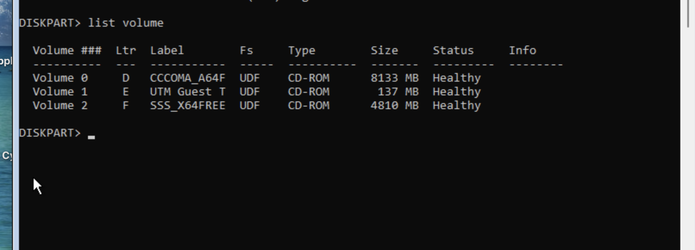

*Figure 1. DiskPart `list volume` from the setup environment. The F: label, `SSS_X64FREE`, shows the first server ISO I attached was an x64 build. That mattered in step 4.*

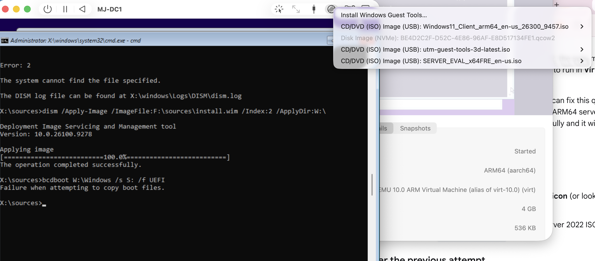

*Figure 2. UTM's removable-drive menu for MJ-DC1, showing the attached ISOs and the VM's ARM64 (aarch64) architecture.*

## 3. Partitioning the virtual disk

A UEFI system needs a GPT disk with a FAT32 EFI system partition for the boot files and an NTFS partition for Windows. I wiped the virtual disk and created both from DiskPart:

```bat
diskpart
select disk 0
clean
convert gpt
create partition efi size=500
format quick fs=fat32 label="System"
assign letter=S          rem EFI system partition
create partition primary
format quick fs=ntfs label="WindowsServer"
assign letter=W          rem Windows partition
exit
```

## 4. Applying the server image

With the partitions in place, the plan was to use DISM to write the server image straight to `W:`, then use BCDBoot to create UEFI boot files on `S:`. It took two attempts.

### Attempt 1 (failed): Windows Server 2022 Evaluation, x64

The first ISO held four Server 2022 editions. I chose index 2, Standard with Desktop Experience.

My first two DISM commands failed on typos: `/ApplyDir:W` without the `:\` returned error 3 (path not found), and a misspelled `insatll.wim` returned error 2 (file not found).

With the command corrected, DISM applied the image successfully, but BCDBoot then failed to copy boot files. The VM's firmware and boot environment are ARM64, and the image I had just applied was x64, so it had no ARM64 UEFI boot files to install. Even with boot files, an x64 Windows install cannot run under ARM64 virtualization, so I abandoned this media.

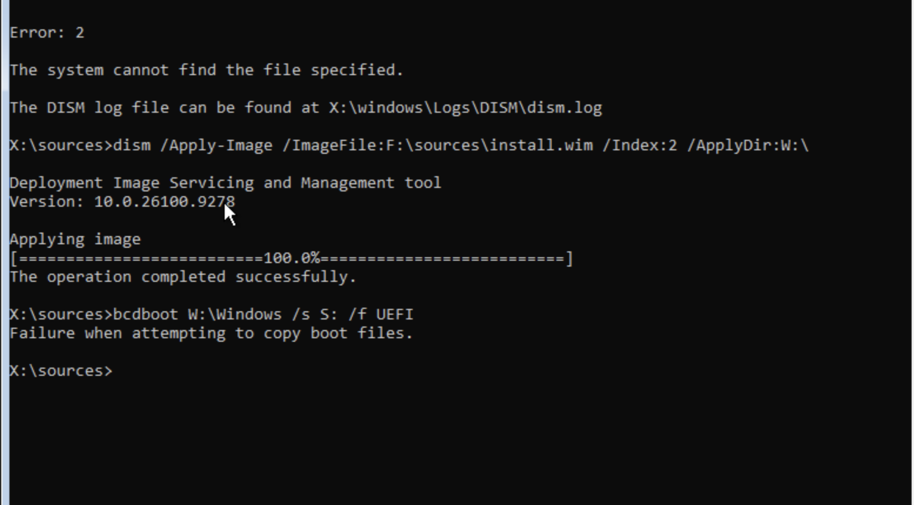

*Figure 3. The x64 image applies, but `bcdboot` fails because of the architecture mismatch.*

### Attempt 2 (succeeded): Windows Server 2025 Standard, ARM64 prerelease build 26212

Microsoft's standard Server evaluation ISOs are x64, so I swapped in a prerelease ARM64 evaluation build of Windows Server 2025 (build 26212). Its image contains a single edition. I repeated the apply and boot steps:

```bat
dism /Get-WimInfo /WimFile:F:\sources\install.wim
dism /Apply-Image /ImageFile:F:\sources\install.wim /Index:1 /ApplyDir:W:\
bcdboot W:\Windows /s S: /f UEFI
```

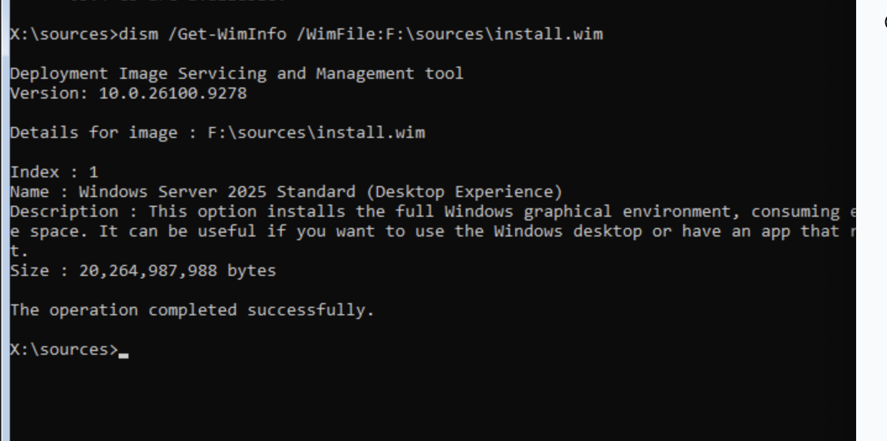

*Figure 4. The ARM64 image: one edition, Server 2025 Standard with Desktop Experience.*

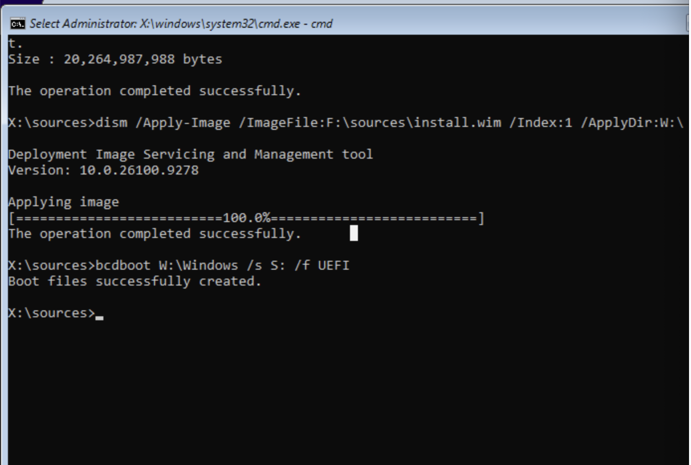

*Figure 5. Image applied and UEFI boot files created.*

## 5. Getting past the setup loop

On first boot from the new disk, Windows setup stopped with an error saying the computer had restarted unexpectedly. Clicking OK restarted the VM and produced the same error each time.

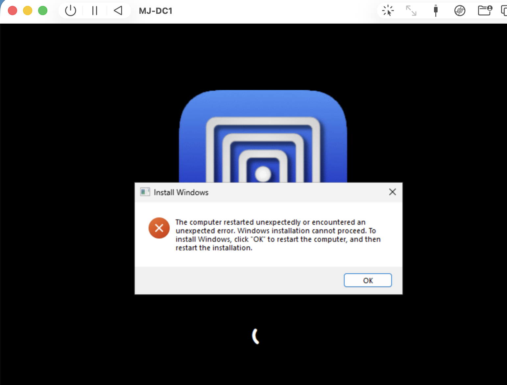

*Figure 6. The setup error that repeated on every restart.*

Setup tracks its own progress in the registry. I pressed Shift + F10 at the error to open a command prompt, launched `regedit`, and went to:

```bat
HKEY_LOCAL_MACHINE\SYSTEM\Setup\Status\ChildCompletion
  setup.exe   REG_DWORD   1  ->  3
```

Changing `setup.exe` from 1 to 3 tells setup that this phase finished successfully. After a restart, Windows continued to the out-of-box setup screens and finished installing.

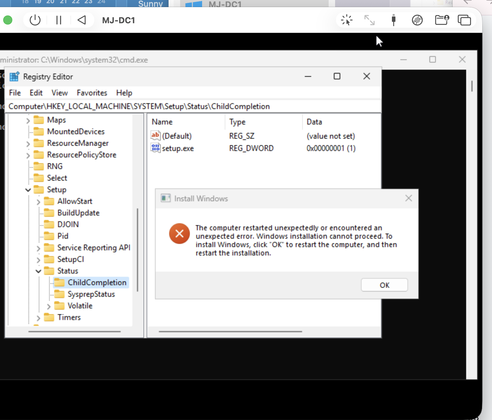

*Figure 7. The ChildCompletion key as found, with `setup.exe` set to 1. I then changed it to 3 and restarted; setup completed on the next boot.*

> **Lab workaround.** This skips a setup check rather than fixing whatever triggered it. It is fine for getting a lab VM running, but I would not use it on a production server. There I would rebuild from supported media.

## 6. Static network configuration

A domain controller needs a fixed address so clients can always find it, and it has to be its own DNS server so it can resolve the records that Active Directory registers. After installing UTM's guest tools, which include the driver for the VM's VirtIO network adapter, I set these on that adapter:

| Setting | Value | Purpose |
|---|---|---|
| IPv4 address | `192.168.64.5` | Fixed address for the domain controller |
| Subnet mask | `255.255.255.0` | Defines the local network, 192.168.64.0/24 |
| Default gateway | `192.168.64.1` | The Mac's shared (NAT) network gateway; routes traffic outside the subnet |
| DNS servers | `127.0.0.1, ::1` | Loopback (IPv4 and IPv6), pointing the server at its own DNS service, which holds the AD records |


*Figure 8. `ipconfig /all` after promotion, before the rename in step 8: DHCP is off, the address is static, DNS points to loopback, and the primary DNS suffix is MJ.local. The watermark identifies the build as Windows Server 2025 Standard, prerelease evaluation build 26212.*

The AD DS promotion wizard sets loopback as DNS by default. For production, Microsoft recommends a partner DC or the server's own IP address as preferred DNS, with loopback listed only as an alternate.

## 7. Promoting the server to a domain controller

I installed the Active Directory Domain Services and DNS roles, then promoted the server to the first domain controller of a new forest with the root domain `MJ.local`.

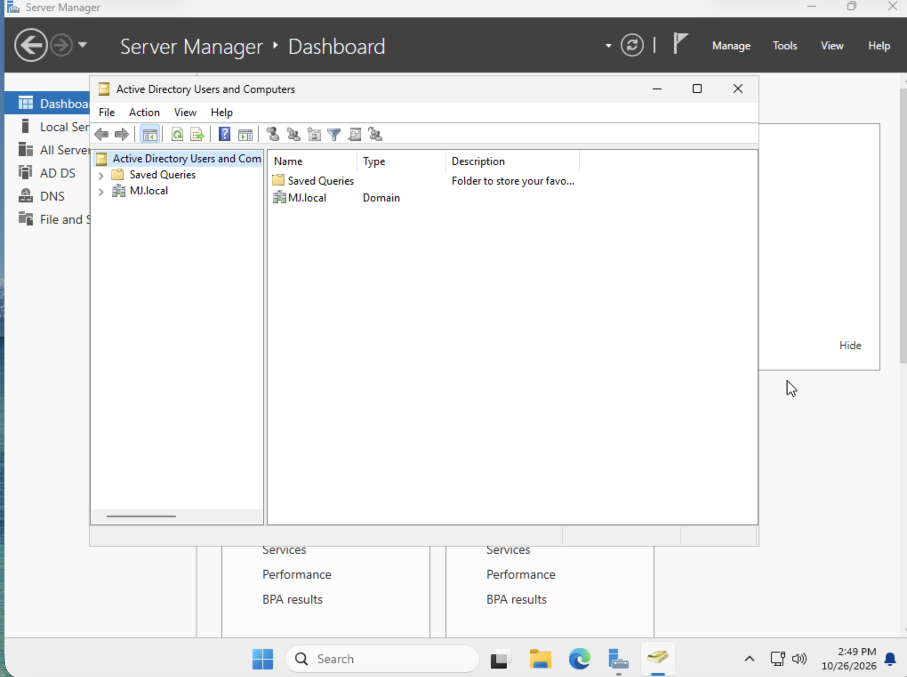

*Figure 9. Active Directory Users and Computers showing the new MJ.local domain. AD DS and DNS appear as installed roles in Server Manager behind it.*

After the promotion restarted the server, I signed in with the domain administrator account, `MJ\Administrator`, confirming the domain was up and authenticating.

## 8. Renaming the domain controller

Checking `ipconfig /all` showed the server had been promoted under the name setup generated, `WIN-2CAIA48M0N8`, rather than MJ-DC1, which until then was only the VM's name in UTM. A domain controller's name is registered in DNS and in Active Directory, so I renamed it with `netdom`, which updates those records, in three stages:

```bat
netdom computername WIN-2CAIA48M0N8.MJ.local /add:MJ-DC1.MJ.local
netdom computername WIN-2CAIA48M0N8.MJ.local /makeprimary:MJ-DC1.MJ.local
shutdown /r /t 0
rem after the restart
netdom computername MJ-DC1.MJ.local /remove:WIN-2CAIA48M0N8.MJ.local
```

Adding the new name worked first time. The first `/makeprimary` attempt failed with "The network path was not found" because I mistyped the current name (`WIN-2CAI484M0N8`), so netdom was looking for a computer that does not exist. Retyped correctly, the command succeeded.

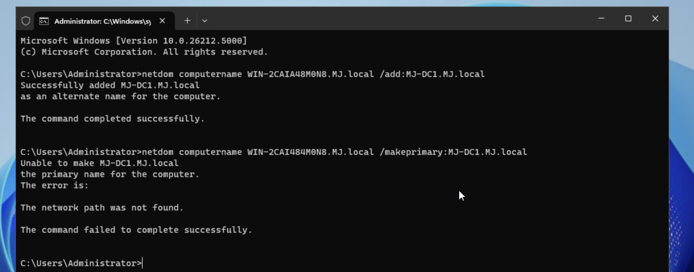

*Figure 10. The alternate name is added, then `/makeprimary` fails on a mistyped computer name.*

After the restart I removed the old name and confirmed the change.

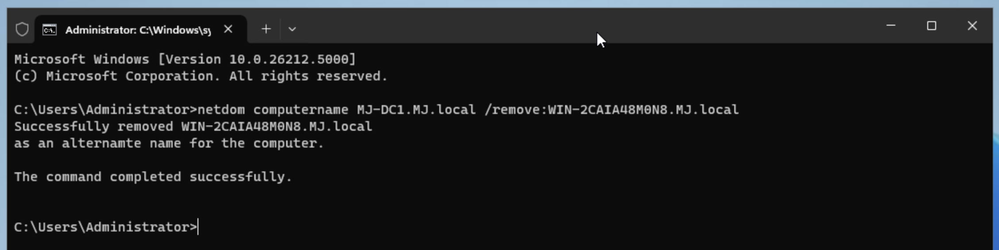

*Figure 11. The old name removed.*

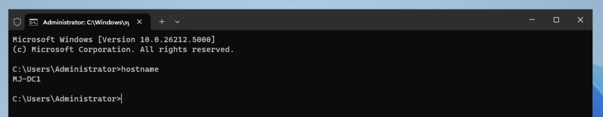

*Figure 12. `hostname` now returns MJ-DC1.*

## 9. Health check with dcdiag

With the rename finished, I ran `dcdiag`, Microsoft's domain controller diagnostic tool, against MJ-DC1. It passed every test except one.

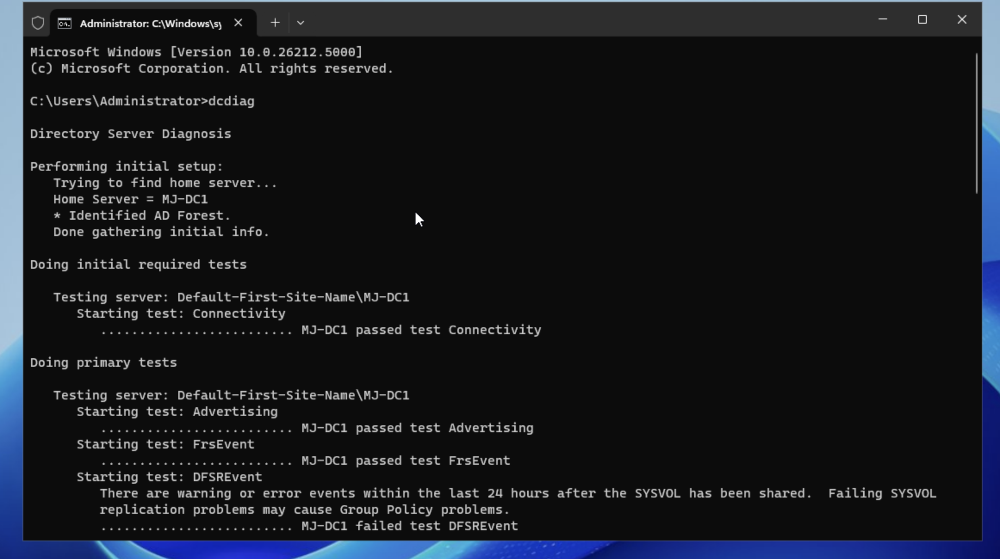

*Figure 13. dcdiag finds MJ-DC1 under its new name and passes connectivity, but flags the DFSREvent test.*

DFSREvent fails when the DFS Replication event log has warnings or errors from the last 24 hours, after SYSVOL was shared. SYSVOL holds Group Policy files, so I investigated it before building any GPOs (below).

The SystemLog test passed with one warning: a DNS lookup for an IPv6 reverse zone (`d.f.ip6.arpa`) timed out. All partition tests (Schema, Configuration, the MJ domain and both DNS application partitions) and the enterprise LocatorCheck and Intersite tests passed.

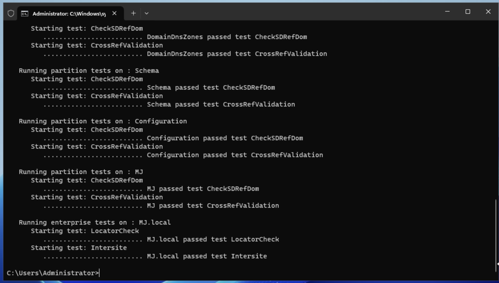

*Figure 14. Partition and enterprise tests on MJ.local, all passed.*

### Investigating the DFSREvent failure

Filtering the DFS Replication log in Event Viewer to errors and warnings returned four events:

| Time (Eastern) | Event | Meaning |
|---|---|---|
| 5:22 PM | Error 1202 | DFS Replication could not contact the domain controller to read its configuration; it retries on the next polling cycle |
| 5:38 PM | Error 1202 | Same |
| 5:43 PM | Warning 6016 | Could not update its configuration in Active Directory; it retries periodically |
| 7:07 PM | Error 1202 | Same as 5:22 PM |

The errors were logged alongside the service's startup events. That fits DFS Replication starting before AD DS and DNS were ready to answer during the restarts that followed promotion; the last one falls around the restart for the rename. One second after the 6016 warning, DFS Replication logged event 4602: it had initialized SYSVOL, with this server as the primary member. No errors or warnings have been logged since 7:07 PM, `net share` lists both SYSVOL and NETLOGON, and dcdiag's SysVolCheck and NetLogons tests passed.

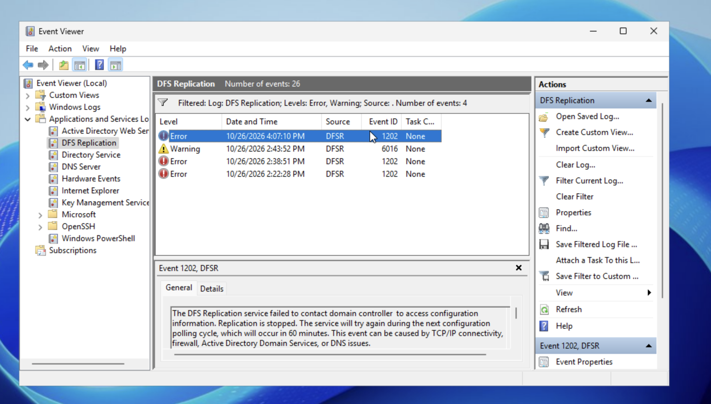

*Figure 15. The four DFS Replication errors and warnings. This screenshot was taken before I corrected the VM's time zone, so it shows Pacific times, three hours behind the Eastern times above.*

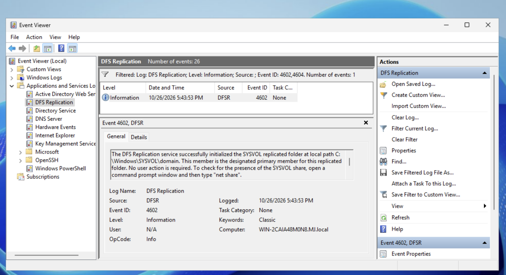

*Figure 16. Event 4602: SYSVOL initialized successfully. It was logged before the rename, so the computer field still shows the old name.*

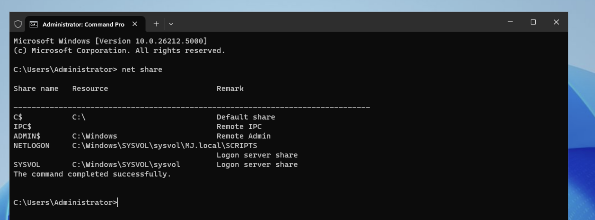

*Figure 17. `net share` shows the SYSVOL and NETLOGON shares that Group Policy and logon scripts depend on.*

**Conclusion:** the failure reflects startup errors from the build, not an ongoing replication fault. DFSREvent should pass once those events are more than 24 hours old.

> **Time zone.** While comparing timestamps I found the VM was set to Pacific time, three hours behind my Mac. I changed it to Eastern so logs and screenshots line up. Kerberos authentication uses UTC, so the mismatch did not affect the domain.

## 10. Lab shortcuts and what I would do in production

| In this lab | In production |
|---|---|
| **Domain named MJ.local.** The `.local` suffix is reserved for multicast DNS (Bonjour), which macOS uses. | Use a subdomain of a registered domain, such as `ad.example.com`, to avoid name-resolution conflicts. |
| **Daily work as MJ\Administrator.** The only account in the domain so far. | Use a separate, named admin account for administration, a standard account for everything else, and keep the built-in Administrator for emergencies. |
| **Setup loop bypassed in the registry.** Gets a lab VM running. | Find the cause in the setup logs and install from supported media. |
| **Renamed after promotion.** The server was promoted as WIN-2CAIA48M0N8 and renamed to MJ-DC1 afterward with netdom. | Set the final name before installing AD DS. It avoids a restart and the extra DNS and directory updates. |
| **Single domain controller.** One VM keeps the lab simple. | Run at least two DCs so authentication and DNS survive the loss of one. |

## 11. Next steps

The domain controller is running. The directory itself is still empty apart from the default containers. Next I plan to:

- Rerun `dcdiag /test:DFSREvent` after 7:10 PM on October 27, when the build-time events leave the 24-hour window, to confirm it passes.
- Point MJ-DC1, the forest's time source, at a reliable external NTP server instead of the default `time.windows.com`.
- Take a UTM snapshot of the clean DC so the lab can be reset quickly.
- Create an `IT Department` organizational unit, a standard test user, and a security group for that department.
- Create and link a Group Policy object that blocks Control Panel for standard users.
- Join a Windows 11 ARM64 client VM to MJ.local and confirm the policy applies when the test user signs in (`gpresult /r`).
- Enable advanced audit policy for logons and account changes, then review the events in Event Viewer.

---

*Lab built and documented by Mujeeb Adeyemi Balogun, October 2026. Screenshots are from the MJ-DC1 virtual machine in UTM.*
