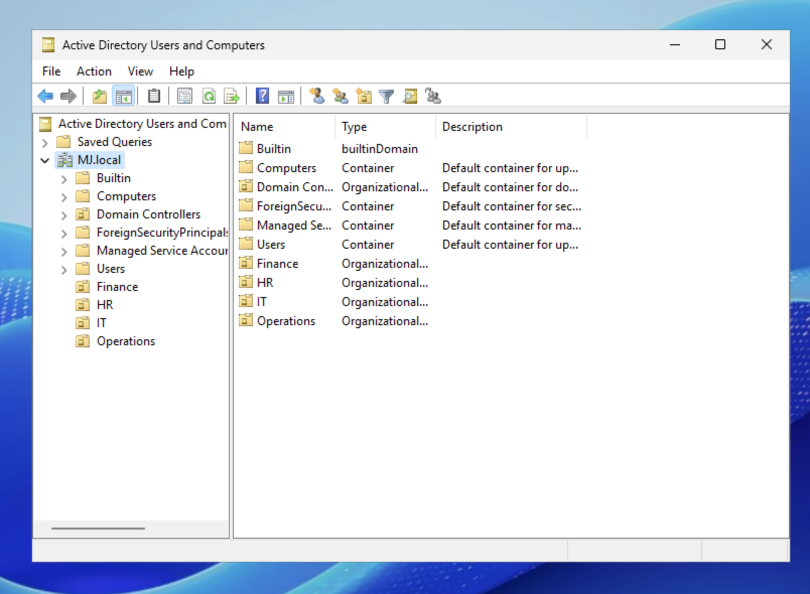
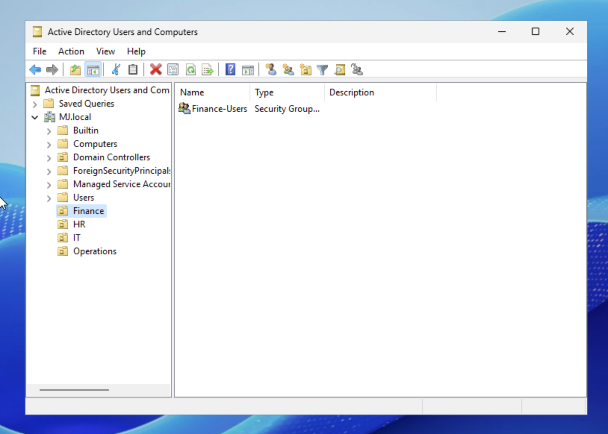
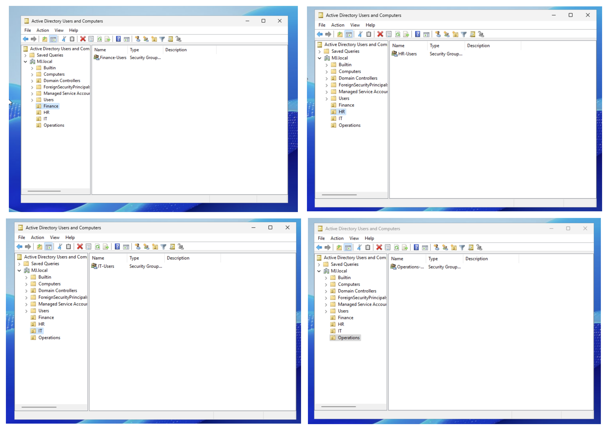
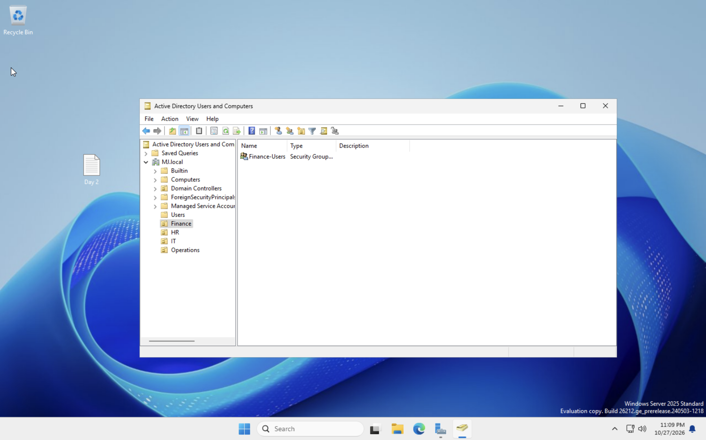

# Day 2: Organizing Active Directory by Department

**Mujeeb Adeyemi Balogun** · October 27, 2026

I gave the empty MJ.local domain from Day 1 a department structure: four organizational units (Finance, HR, IT and Operations), each holding one global security group for that department's staff. This is the layout every user account and access permission will be built on from Day 3 onward. The report also answers the four Phase 4 questions on why the structure works this way.

> This lab uses MJ.local in place of the training scenario's NMG.com; names and sign-ins follow that domain.

| Item | Value |
|---|---|
| **Scenario** | Northstar Medical Group (NMG.com) |
| **Lab domain** | MJ.local (stand-in for NMG.com) |
| **Domain controller** | MJ-DC1, Windows Server 2025 |
| **OUs created** | 4: Finance, HR, IT, Operations |
| **Security groups** | 4, all Global scope, Security type |
| **Tool** | Active Directory Users and Computers |

**Tools:** `Active Directory Users and Computers` · `Organizational Units` · `Security groups`

## Contents

- [1. The problem](#1-the-problem)
- [2. The design](#2-the-design)
- [3. Creating the OUs](#3-creating-the-ous)
- [4. Creating the security groups](#4-creating-the-security-groups)
- [5. Verification and documentation](#5-verification-and-documentation)
- [6. Phase 4: understanding what I built](#6-phase-4-understanding-what-i-built)
- [7. Lab choices and what I would do in production](#7-lab-choices-and-what-i-would-do-in-production)
- [8. Next steps](#8-next-steps)

## 1. The problem

Northstar's previous IT provider added users at random, with no departments and no consistent access. After Day 1, the new MJ.local domain held only the containers Windows creates by default, so there was nowhere sensible to put a department's staff or attach its access.

Day 2's job is to fix the layout before any accounts exist: one place per department for its people, and one group per department to carry its permissions.

## 2. The design

Each department gets its own OU, and each OU holds the department's security group. All four OUs sit directly under the domain, alongside the default containers:

```bat
MJ.local
├── Builtin, Computers, Users, ...   (default containers, unchanged)
├── Finance      OU
│   └── Finance-Users       Global security group
├── HR           OU
│   └── HR-Users            Global security group
├── IT           OU
│   └── IT-Users            Global security group
└── Operations   OU
    └── Operations-Users    Global security group
```

| OU | Security group | Who it is for at Northstar |
|---|---|---|
| Finance | `Finance-Users` | Billing, insurance claims, payroll and accounts staff |
| HR | `HR-Users` | Hiring, employee records and benefits staff |
| IT | `IT-Users` | Systems administration and help desk staff |
| Operations | `Operations-Users` | Clinic operations, scheduling, front desk and facilities staff |

I created new OUs rather than using the default Users container because the default containers are not OUs: Group Policy cannot be linked to them, and administration cannot be delegated per department. The naming is consistent on purpose, so the group for any department can be found without looking it up.

## 3. Creating the OUs

In Active Directory Users and Computers, I right-clicked the domain, chose **New → Organizational Unit**, and created Finance, HR, IT and Operations. Following the lab instructions, I left "Protect container from accidental deletion" unchecked.



*Figure 1. The four new OUs under MJ.local, shown with the OU icon, alongside the default containers.*

## 4. Creating the security groups

In each OU I chose **New → Group** and created one group with the same settings:

| Group name | Created in OU | Scope | Type |
|---|---|---|---|
| `Finance-Users` | Finance | Global | Security |
| `HR-Users` | HR | Global | Security |
| `IT-Users` | IT | Global | Security |
| `Operations-Users` | Operations | Global | Security |

**Security** type means the group can be granted permissions; a Distribution group is only for email lists. **Global** scope fits groups that collect users by role: it holds accounts from this domain and can still be granted access to resources anywhere in the forest.



*Figure 2. The Finance OU containing the Finance-Users security group.*



*Figure 3. Each OU with its group: Finance-Users, HR-Users, IT-Users and Operations-Users (the last name is cut off by the column width).*

## 5. Verification and documentation

I opened each OU and confirmed it contains its own group and nothing else:

- Finance OU contains Finance-Users
- HR OU contains HR-Users
- IT OU contains IT-Users
- Operations OU contains Operations-Users

I also saved a Day 2 documentation file on the server's desktop, as the Phase 3 checklist asks.



*Figure 4. The Day 2 documentation file on the MJ-DC1 desktop, with the finished structure open beside it.*

## 6. Phase 4: understanding what I built

### Why would you put a user in the Finance OU instead of the HR OU?

Because that user works in Finance. An OU's job is organization and management: it is where Group Policy settings are applied and where administrative control can be delegated. A Finance employee in the Finance OU receives Finance's policies and can be managed by whoever looks after Finance accounts. Putting someone in an OU does not give them access to any file or system on its own.

### What happens when you add a user to the Finance-Users security group?

The user gets every permission the group has been granted, and loses it when removed from the group. Right now Finance-Users has not been given access to anything, so membership grants nothing yet. Once the group is given access to, say, a Finance shared drive, every member has it automatically.

### If Finance users need a Finance shared drive, which group manages that access?

Finance-Users. I would grant the group permission on the share and its folders, and never grant individual users. Larger environments often add one more layer, putting Finance-Users inside a resource group that holds the permission (the AGDLP model), but at Northstar's size granting Finance-Users directly is reasonable.

### Why manage access through security groups instead of user by user?

- **Consistency.** Everyone in a role gets exactly the same access, which removes the over- and under-permissioned accounts Northstar has now.
- **Speed.** A new hire's access becomes one group membership instead of days of individual requests.
- **Clean offboarding.** Removing a leaver from their groups removes their access everywhere, with nothing forgotten.
- **Auditability.** Who can reach a system is answered by reading one group's member list, which is the evidence a HIPAA access review asks for.
- **Less error.** One change to a group updates access for the whole department, instead of repeating it user by user.

## 7. Lab choices and what I would do in production

| In this lab | In production |
|---|---|
| **OUs not protected from accidental deletion**, as the lab instructions say. | Leave protection on, so a stray click cannot delete a department OU and everything in it. |
| **Domain named MJ.local** instead of NMG.com. | Use the company's naming, ideally a subdomain of a domain it owns, such as `corp.nmg.com`. |
| **Groups granted no permissions yet.** | Grant each group access to its department's shares and applications as they are set up, never to individual users. |

## 8. Next steps

- Create user accounts in each department's OU and add them to that department's group.
- Grant each group access to its department's resources, starting with a shared folder per department.
- Link Group Policy objects to the OUs, such as the Control Panel restriction for standard users.
- Rerun `dcdiag /test:DFSREvent` to close out the open Day 1 item.

---

*Lab built and documented by Mujeeb Adeyemi Balogun, October 2026. Screenshots are from the MJ-DC1 virtual machine in UTM. Day 1 covers building the domain controller.*
