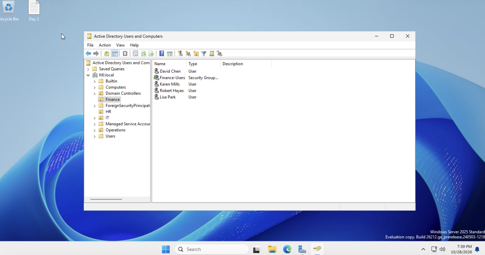
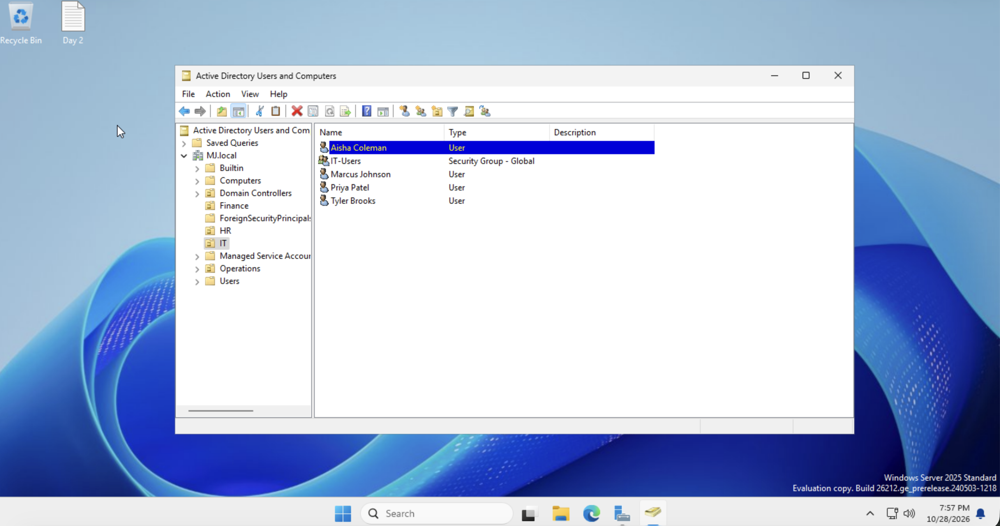
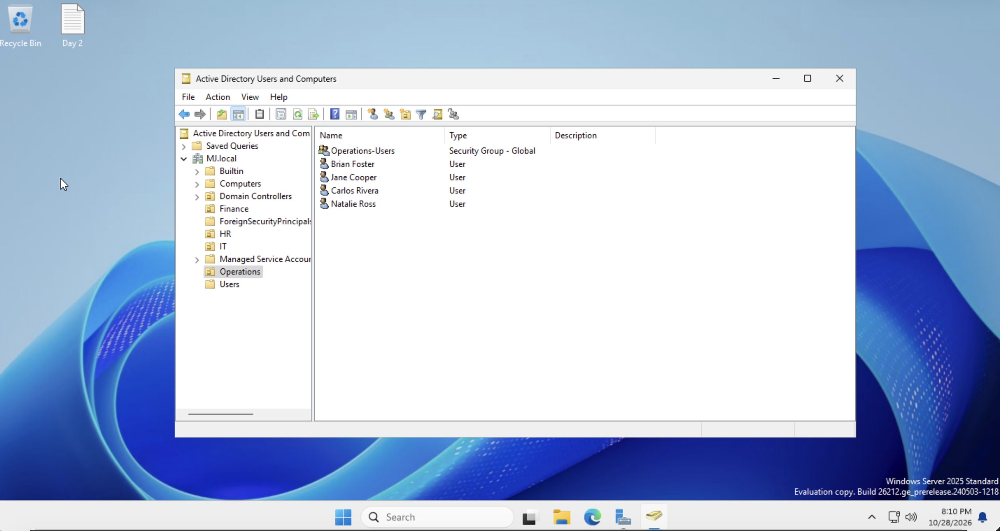
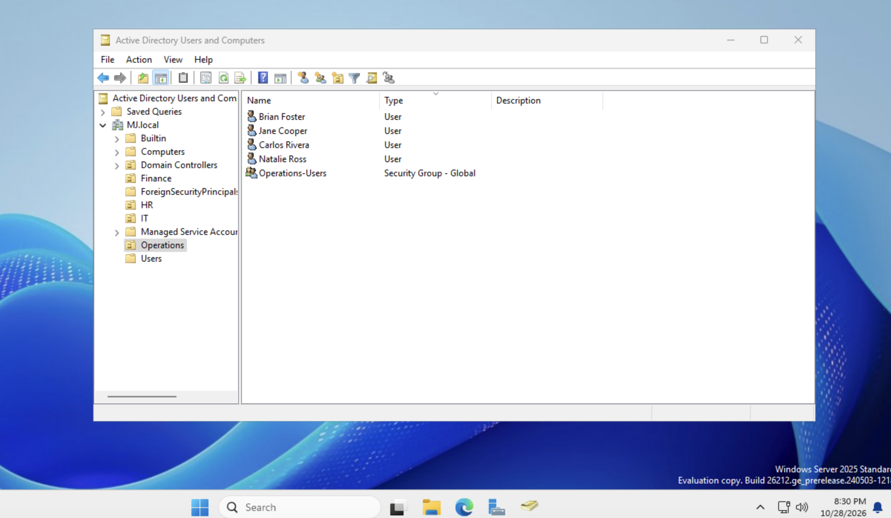
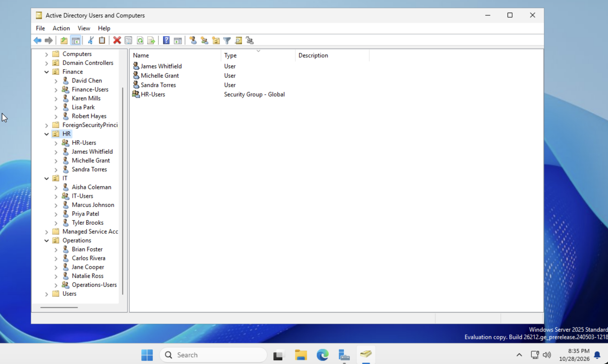

# Day 3: People and Permissions

**Mujeeb Adeyemi Balogun** · October 28, 2026

I created Northstar's 15 staff accounts, each in its department's OU under one consistent naming convention, and added every user to their department's security group. Access is now tied to role rather than to individual people: the role-based access control (RBAC) that Northstar's previous provider never set up. The screenshots below keep the server's on-screen clock and date as a time-stamped record of each step.

> This lab uses MJ.local in place of the training scenario's NMG.com; names and sign-ins follow that domain.

| Item | Value |
|---|---|
| **Scenario** | Northstar Medical Group (NMG.com) |
| **Lab domain** | MJ.local (stand-in for NMG.com) |
| **Domain controller** | MJ-DC1, Windows Server 2025 |
| **Accounts created** | 15 across 4 departments |
| **Group memberships** | 15: one department group per user |
| **Work window** | 7:39 PM to 8:35 PM, October 28, 2026 |

**Tools:** `Active Directory Users and Computers` · `User accounts` · `Security groups` · `RBAC`

## Contents

- [1. The goal](#1-the-goal)
- [2. The ideas behind today's build](#2-the-ideas-behind-todays-build)
- [3. Naming convention](#3-naming-convention)
- [4. The accounts](#4-the-accounts)
- [5. Assigning group membership (RBAC)](#5-assigning-group-membership-rbac)
- [6. Verification](#6-verification)
- [7. How this helps Northstar](#7-how-this-helps-northstar)
- [8. Lab choices and what I would do in production](#8-lab-choices-and-what-i-would-do-in-production)
- [9. Next steps](#9-next-steps)

## 1. The goal

Day 2 gave the domain a department structure: four OUs, each with one security group. Day 3 fills it with people. Every account goes in its department's OU, and every person joins their department's group, so access can be granted to a role once instead of to each person separately.

This addresses two of the problems Northstar inherited from its previous provider: accounts created at random with no structure, and inconsistent access from person to person.

## 2. The ideas behind today's build

Today's lab applies three ideas from the Day 3 lesson. Each one explains a choice made in the steps that follow.

### A digital identity is a set of attributes

A user account is more than a username and password. It is a set of attributes that describe the person, and other systems rely on those attributes being exact:

| Attribute | Example | Why consistency matters |
|---|---|---|
| sAMAccountName | `dchen` | The sign-in name; must be unique across the whole domain |
| UserPrincipalName (UPN) | `dchen@NMG.com` | The email-style sign-in that cloud services such as Microsoft Entra ID use to identify the user |
| Display name | `David Chen` | How the person appears in every directory and address list |
| Department | `Finance` | Must be spelled identically for everyone, so reports, rules and automation can rely on it |
| Job title | `Finance Manager` | Records the role the person's access is based on |
| Group membership | `Finance-Users` | What actually decides the person's access |

When Active Directory is connected to a cloud directory or an HR system, the systems match users by these values. If one attribute differs, for example `jsmith@NMG.com` in one system and `jane.smith@NMG.com` in the other, the match fails without an obvious error and the person ends up with two identities or no access. That is why every account today follows one naming rule and uses the same department names.

### Role-based access control (RBAC)

Broken access control, meaning the wrong people holding access to the wrong things, is ranked first (A01) in the 2025 OWASP Top 10, the most widely referenced list of security risks. RBAC is the standard answer to it, formalized by NIST: access is granted to a role, and a person receives access by being assigned that role.

In this lab each department group is a role. It gives Northstar three things it lacked: **consistency** (every Finance user gets the same access), **scalability** (the 50th hire needs one group membership, not a fresh setup) and **auditability** ("who can reach Finance systems?" is answered by one member list).

### Least privilege

Every user should have exactly the access their job needs and nothing more, so a compromised account exposes only that role's data. Today each user belongs to exactly one department group, with no cross-department memberships. The groups do not hold any permissions yet; least privilege will decide what each one is granted when resources are added.

### Centralized identity

Because every account lives in one directory, a leaver is disabled once and loses access to everything that relies on Active Directory, instead of being removed system by system with the risk of missing one.

## 3. Naming convention

Before creating any account, I fixed one rule for every username so names stay predictable and unique:

| Attribute | Rule | Example |
|---|---|---|
| Username (sAMAccountName) | First initial + last name, all lowercase, no spaces | `dchen` |
| Sign-in name (UPN) | Username + @ + domain suffix | `dchen@NMG.com in the guide` |
| Display name | First name + last name | `David Chen` |

The convention matters most when names collide. Robert Hayes in Finance shares a surname with Jordan M. Hayes, Northstar's IT manager. Their usernames, `rhayes` and `jhayes`, keep them apart; a bare `hayes` would be ambiguous and invite the wrong account being given the wrong access.

In this lab the domain is MJ.local, so sign-in names use the domain's own suffix instead of @NMG.com.

## 4. The accounts

I created each account by right-clicking its department's OU and choosing **New → User**, entering the first name, last name, username, job title and department from the lab guide:

| Name | Username | Job title | Department OU and group |
|---|---|---|---|
| David Chen | `dchen` | Finance Manager | Finance · Finance-Users |
| Karen Mills | `kmills` | Finance Analyst | Finance · Finance-Users |
| Robert Hayes | `rhayes` | Payroll Specialist | Finance · Finance-Users |
| Lisa Park | `lpark` | Accounts Payable | Finance · Finance-Users |
| Sandra Torres | `storres` | HR Manager | HR · HR-Users |
| James Whitfield | `jwhitfield` | HR Recruiter | HR · HR-Users |
| Michelle Grant | `mgrant` | Benefits Coordinator | HR · HR-Users |
| Marcus Johnson | `mjohnson` | IT Administrator | IT · IT-Users |
| Priya Patel | `ppatel` | Security Analyst | IT · IT-Users |
| Tyler Brooks | `tbrooks` | Help Desk Technician | IT · IT-Users |
| Aisha Coleman | `acoleman` | Systems Engineer | IT · IT-Users |
| Brian Foster | `bfoster` | Operations Manager | Operations · Operations-Users |
| Jane Cooper | `jcooper` | Operations Coordinator | Operations · Operations-Users |
| Carlos Rivera | `crivera` | Facilities Supervisor | Operations · Operations-Users |
| Natalie Ross | `nross` | Scheduling Coordinator | Operations · Operations-Users |

All 15 accounts share one lab password, with "Password never expires" set and "User must change password at next logon" cleared, following the lab guide's settings. Section 8 explains why none of that would be acceptable in production. The password itself is deliberately left out of this report.

### Finance: 4 users



*Figure 1. Finance OU at 7:39 PM on October 28, 2026: David Chen, Karen Mills, Robert Hayes and Lisa Park, alongside the Finance-Users group.*

### HR: 3 users


*Figure 2. HR OU at 7:47 PM: Sandra Torres, James Whitfield and Michelle Grant, alongside HR-Users.*

### IT: 4 users



*Figure 3. IT OU at 7:57 PM: Aisha Coleman, Marcus Johnson, Priya Patel and Tyler Brooks. The Type column shows IT-Users as "Security Group - Global".*

### Operations: 4 users



*Figure 4. Operations OU at 8:10 PM: Brian Foster, Jane Cooper, Carlos Rivera and Natalie Ross, with Operations-Users shown as "Security Group - Global".*

The lab guide flags Jane Cooper as needed for Day 4, so I checked her placement again before finishing:



*Figure 5. Operations OU rechecked at 8:30 PM: Jane Cooper is in place with the rest of Operations.*

## 5. Assigning group membership (RBAC)

With all 15 accounts in place, I added each user to their department's group from the account's **Properties → Member Of → Add**. The result is one role group per department:

| Security group | Members | Count |
|---|---|---|
| `Finance-Users` | dchen, kmills, rhayes, lpark | 4 |
| `HR-Users` | storres, jwhitfield, mgrant | 3 |
| `IT-Users` | mjohnson, ppatel, tbrooks, acoleman | 4 |
| `Operations-Users` | bfoster, jcooper, crivera, nross | 4 |

From here on, anything a department needs, such as a shared folder or an application, is granted to its group once. Every current member gets it, and every future member gets it automatically when they join the group.

## 6. Verification

For the final check I expanded every department OU in a single tree view, with ADUC set to show users and groups as tree items. Each OU holds exactly its own users and its own group, and nothing is misplaced:



*Figure 6. The full structure at 8:35 PM: Finance (4 users + Finance-Users), HR (3 + HR-Users), IT (4 + IT-Users) and Operations (4 + Operations-Users).*

I also saved the Phase 3 documentation record:

```bat
Total users created: 15
Finance users:    dchen, kmills, rhayes, lpark
HR users:         storres, jwhitfield, mgrant
IT users:         mjohnson, ppatel, tbrooks, acoleman
Operations users: bfoster, jcooper, crivera, nross
All users assigned to correct security groups
Date completed: October 28, 2026
```

### What each piece of evidence proves

| Evidence | Time (Oct 28) | What it shows |
|---|---|---|
| Figure 1, Finance OU | 7:39 PM | 4 Finance accounts in the Finance OU |
| Figure 2, HR OU | 7:47 PM | 3 HR accounts in the HR OU |
| Figure 3, IT OU | 7:57 PM | 4 IT accounts; IT-Users is a global security group |
| Figure 4, Operations OU | 8:10 PM | 4 Operations accounts; Operations-Users is a global security group |
| Figure 5, Operations recheck | 8:30 PM | Jane Cooper confirmed in Operations before Day 4 |
| Figure 6, full tree | 8:35 PM | All 15 accounts and 4 groups in their correct OUs |
| Documentation record | Oct 28 | Full user list by department and group |

## 7. How this helps Northstar

- **Structure instead of randomness.** Every account has a predictable name and sits in its department's OU.
- **Consistent access.** Access now flows from department groups, so two people in the same role cannot quietly end up with different permissions.
- **A repeatable onboarding process.** A new hire is one account in the right OU plus one group membership, a process that can now be written down and followed.
- **Cleaner offboarding and audits.** Removing a leaver's group membership removes their department access, and a group's member list shows who has access at a glance.

## 8. Lab choices and what I would do in production

| In this lab | In production |
|---|---|
| **One shared password for all 15 accounts.** | A unique temporary password per person, delivered securely. |
| **"User must change password at next logon" cleared.** | Leave it checked, so only the employee ever knows their password. |
| **"Password never expires" set.** | Follow the domain password policy and add multi-factor authentication; reserve non-expiring passwords for tightly controlled service accounts. |
| **Accounts created one by one in ADUC.** | Create accounts from an HR-approved list with a PowerShell script, so every attribute is set the same way and the process can be audited. |
| **Sign-in names use the MJ.local suffix.** | Use the organization's own domain, such as an @nmg.com sign-in suffix. |

## 9. Next steps

- Day 4: carry on with Jane Cooper's account, which the lab guide says will be used next.
- Grant each department group access to its resources, starting with a shared folder per department.
- Write the onboarding and offboarding steps as a short checklist, using today's process as the template.

---

*Lab built and documented by Mujeeb Adeyemi Balogun, October 2026. Screenshots are from the MJ-DC1 virtual machine in UTM and keep the server's clock as a timestamp. Day 1 covers building the domain controller; Day 2 covers the OUs and groups.*
