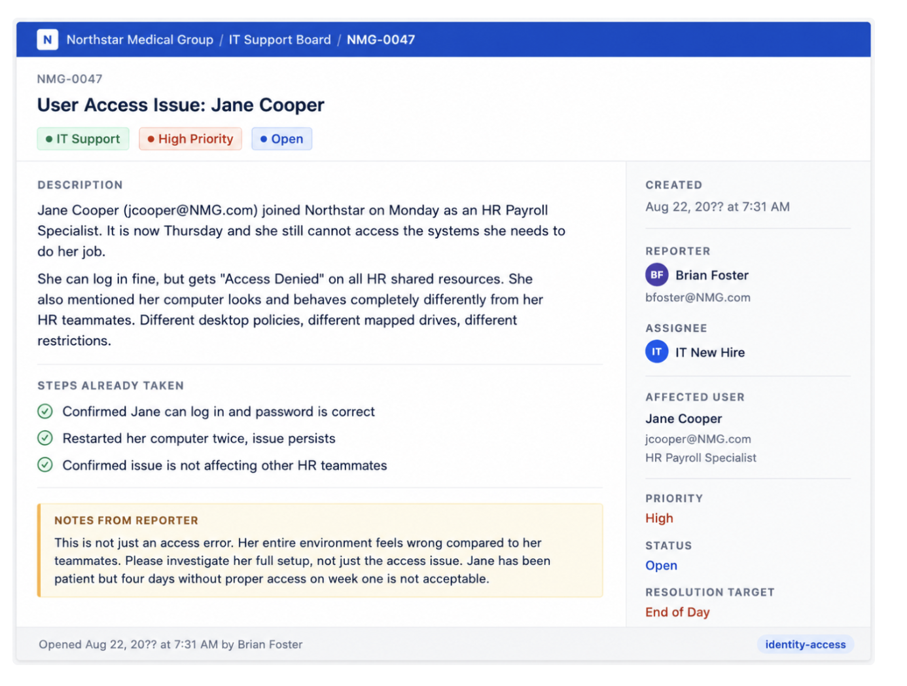
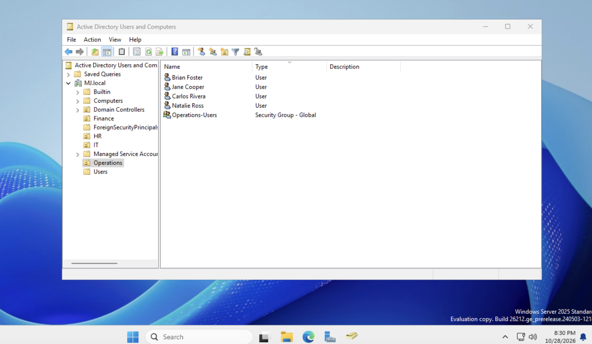
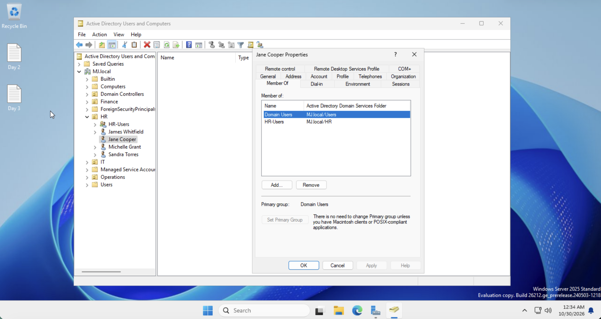
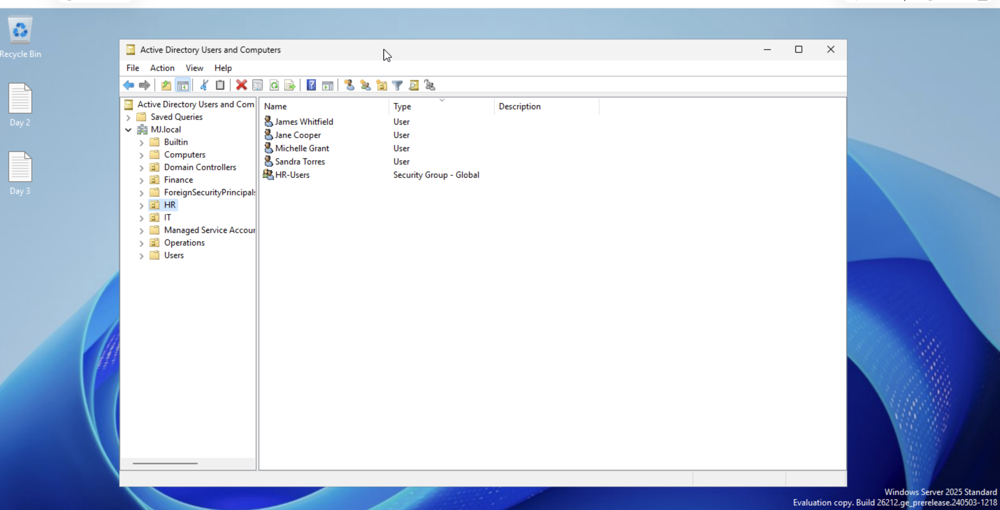
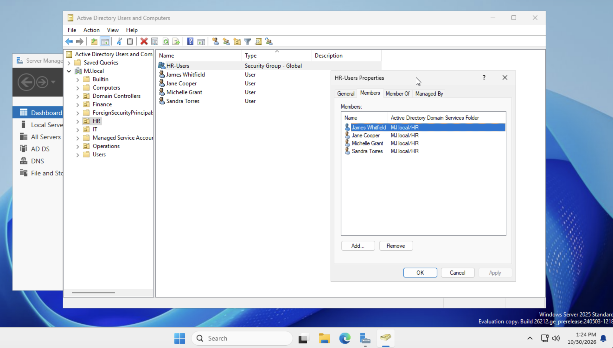
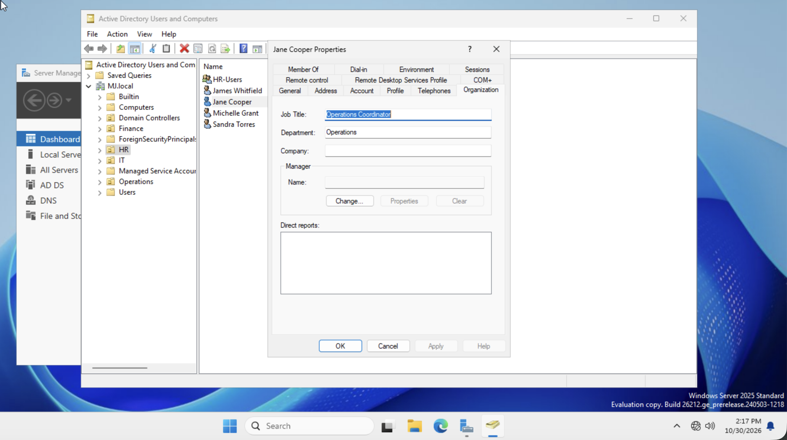
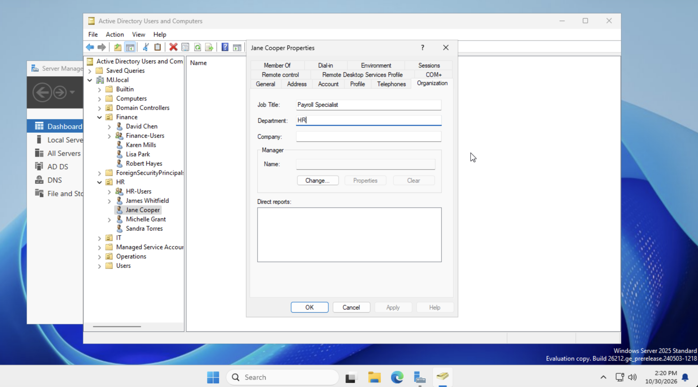

# Day 4: Resolving Ticket NMG-0047

**Mujeeb Adeyemi Balogun** · October 29–30, 2026

Jane Cooper could sign in but was denied access to HR resources, and her desktop behaved differently from her HR teammates. I investigated before changing anything and found one root cause behind both symptoms: her account had been set up in the wrong department. It sat in the Operations OU and the Operations-Users group, while the ticket identifies her as an HR Payroll Specialist. I moved her to the HR OU, replaced Operations-Users with HR-Users, updated her job title and department to match, and verified the result.

> This lab uses MJ.local in place of the training scenario's NMG.com; names and sign-ins follow that domain.

| Item | Value |
|---|---|
| **Ticket** | NMG-0047, High priority, due end of day |
| **Affected user** | Jane Cooper (jcooper) |
| **Reported by** | Brian Foster |
| **Root cause** | Account provisioned to the wrong department |
| **Fix** | Moved to HR OU; Operations-Users replaced with HR-Users; title and department updated |
| **Status** | Resolved; follow-ups in section 9 |

**Tools:** `Active Directory Users and Computers` · `Five Whys` · `OU placement` · `Group membership`

## Contents

- [1. The ticket](#1-the-ticket)
- [2. Approach](#2-approach)
- [3. Symptoms](#3-symptoms)
- [4. Investigation](#4-investigation)
- [5. Root cause: the Five Whys](#5-root-cause-the-five-whys)
- [6. Fix applied](#6-fix-applied)
- [7. Verification](#7-verification)
- [8. Why the error existed](#8-why-the-error-existed)
- [9. Follow-ups before closing](#9-follow-ups-before-closing)
- [10. Preventing a repeat](#10-preventing-a-repeat)
- [11. Resolution record](#11-resolution-record)

## 1. The ticket

Jordan Hayes assigned ticket NMG-0047 while he was tied up with a vendor escalation, and asked for it to be fixed and documented by end of day.



*Figure 1. Ticket NMG-0047 as received. Jane is listed as an HR Payroll Specialist; the reporter asks for her full setup to be investigated, not just the access error.*

The reporter's note matters: "This is not just an access error. Her entire environment feels wrong compared to her teammates." That rules out treating the Access Denied message on its own.

## 2. Approach

I followed an investigate-first workflow, separating diagnosis from action:

- Read the ticket fully and list only the observable symptoms.
- Collect evidence from Active Directory for each symptom: OU, group memberships, and a comparison with a working teammate.
- Form a hypothesis and check that it explains every symptom, not just one.
- Only then make the change, and verify that each symptom is resolved.

Changing things before the problem is understood can grant access someone should not have, hides which change actually worked, and leaves the real cause in place.

## 3. Symptoms

| # | Symptom | Source |
|---|---|---|
| 1 | "Access Denied" on all HR shared resources | Ticket description |
| 2 | Different desktop policies, mapped drives and restrictions from her HR teammates | Ticket description and reporter's note |
| 3 | Sign-in and password work normally; restarts did not help | Steps already taken |
| 4 | Only Jane is affected, not the rest of HR | Steps already taken |

Symptoms 3 and 4 narrow the search: the account exists and authenticates, and the HR setup works for everyone else, so the fault is specific to how Jane's account is configured.

## 4. Investigation

I compared Jane's account with her HR teammates' accounts in Active Directory Users and Computers.

| Check | Jane Cooper (before) | HR teammates | Expected for an HR Payroll Specialist |
|---|---|---|---|
| OU | Operations | HR | HR |
| Department group | Operations-Users | HR-Users | HR-Users |
| Default group | Domain Users | Domain Users | Domain Users |

The "before" state is recorded in the Day 3 evidence, which shows Jane's account in the Operations OU:



*Figure 2. Before the fix (Day 3, 8:30 PM on October 28): Jane Cooper in the Operations OU, alongside Operations-Users.*

Both her OU and her group pointed to Operations, while her role and her teammates are in HR.

## 5. Root cause: the Five Whys

### Symptom 1: Access Denied on HR resources

- **Why** is access denied? She has no permission on the HR resources.
- **Why** no permission? HR resources are granted to the HR-Users group.
- **Why** does that not include her? She is not a member of HR-Users.
- **Why** not? Her account was given the Operations group instead.
- **Why?** The account was provisioned for the wrong department.

### Symptom 2: Different desktop, drives and restrictions

- **Why** is her environment different? Different Group Policy settings apply to her.
- **Why?** Group Policy is applied to user accounts according to the OU they sit in.
- **Why** does that differ from her teammates? She is in the Operations OU, not HR.
- **Why?** She was placed there when the account was created.
- **Why?** The account was provisioned for the wrong department.

**Hypothesis:** both symptoms come from one root cause, an account provisioned to the wrong department. It produced two separate faults that both need fixing: the wrong **group**, which controls access, and the wrong **OU**, which controls policy.

| Symptom | Explained by the hypothesis? |
|---|---|
| Access Denied on HR resources | Yes: not in HR-Users |
| Different desktop, drives, restrictions | Yes: in the Operations OU, so Operations policy applies |
| Sign-in works | Yes: the account itself is valid |
| Only Jane affected | Yes: the error is in her account alone |

The hypothesis explains all four symptoms, so I moved on to the fix. Fixing only the group would have restored access but left her desktop wrong, and Brian would have reopened the ticket.

## 6. Fix applied

| Change | Before | After | Fixes |
|---|---|---|---|
| OU placement | Operations | HR | Symptom 2 (policy, drives, restrictions) |
| Department group | Operations-Users | HR-Users | Symptom 1 (Access Denied) |
| Domain Users | Member | Member (unchanged) | Default group for every domain account |
| Job title | Operations Coordinator | Payroll Specialist | Account details match her real role |
| Department | Operations | HR | Account details match her real role |

I moved the account to the HR OU, then on her **Properties → Member Of** tab removed Operations-Users and added HR-Users. On the **Organization** tab I changed her job title and department, which still described her Day 3 Operations role. Removing the old group mattered as much as adding the new one: keeping both would have left her with Operations access she no longer needs, which breaks least privilege.

## 7. Verification



*Figure 3. 12:34 AM, October 30: Jane Cooper now sits under the HR OU, and her Member Of tab lists only Domain Users and HR-Users. Operations-Users is gone.*



*Figure 4. The HR OU now holds James Whitfield, Jane Cooper, Michelle Grant and Sandra Torres, with HR-Users.*



*Figure 5. 1:24 PM, October 30: the HR-Users group lists four members, all in MJ.local/HR, including Jane Cooper.*



*Figure 6. 2:17 PM, October 30: Jane's Organization tab before the update, still showing her Day 3 job title (Operations Coordinator) and department (Operations).*



*Figure 7. 2:20 PM, October 30: the same tab after the update, with Job Title "Payroll Specialist" and Department "HR".*

| Symptom | Verified by | Result |
|---|---|---|
| Wrong group | Jane's Member Of tab and HR-Users Members tab | Fixed |
| Wrong OU | HR OU contents and Jane's position in the tree | Fixed |
| No leftover Operations access | Member Of tab shows no Operations-Users | Fixed |
| Account details | Organization tab: title and department | Fixed |
| Desktop and drives match HR | Jane signs out and back in; `gpresult /r` on her PC | Pending (needs a client PC) |

Group changes take effect at Jane's next sign-in, because her access token is built at sign-in. This lab has no client computer or HR Group Policy objects yet, so the policy side can only be confirmed from the directory, not from her desktop.

## 8. Why the error existed

The fault was planted on purpose. On Day 3 the lab guide had me create Jane Cooper in the Operations OU and add her to Operations-Users, and it flagged her account as one that would be used again. On Day 4 the ticket identifies her as an HR Payroll Specialist, so that Day 3 setup became the misconfiguration to find and fix.

This mirrors a common real-world failure: an account built from the wrong details on day one, which then looks like an access problem rather than a setup problem. The ticket only says what the user sees; the cause has to be found in the directory.

## 9. Follow-ups before closing

- **Set her Manager field** on the Organization tab (optional; it is empty, as it is for every lab account).
- **Ask Jane to sign out and back in**, then confirm she can open HR resources and that `gpresult /r` shows HR policy.
- **Reply to Brian on the ticket** with the cause, the fix and what Jane needs to do.

## 10. Preventing a repeat

The fault was not in Active Directory; it was in how the account was created. To stop it happening again:

- Create accounts from HR-approved new-starter details (name, title, department, manager), not from memory or email.
- Use a short provisioning checklist: correct OU, correct department group, attributes filled in.
- Before handing over a new account, compare it with a teammate's account in the same role.

## 11. Resolution record

The ticket resolution was saved as `MJ.local-001-Resolution.txt`:

```bat
Ticket:        NMG-0047
Affected user: Jane Cooper (jcooper@MJ.local)
Issue:         Access Denied on HR shared resources; desktop policies
               and mapped drives differ from HR teammates
Root cause:    Account provisioned to the wrong department:
               Operations OU and Operations-Users instead of HR
Fix:           Moved to HR OU; removed from Operations-Users;
               added to HR-Users;
               Job Title -> Payroll Specialist; Department -> HR
Verification:  Member Of shows Domain Users + HR-Users only;
               Jane listed in HR OU and in HR-Users members;
               Organization tab shows the new title and department
Resolved:      October 29, 2026 (verified October 30)
Resolved by:   Mujeeb Balogun
```

---

*Lab built and documented by Mujeeb Adeyemi Balogun, October 2026. Screenshots are from the MJ-DC1 virtual machine in UTM and keep the server's clock as a timestamp. The ticket image is from the Northstar training scenario.*
